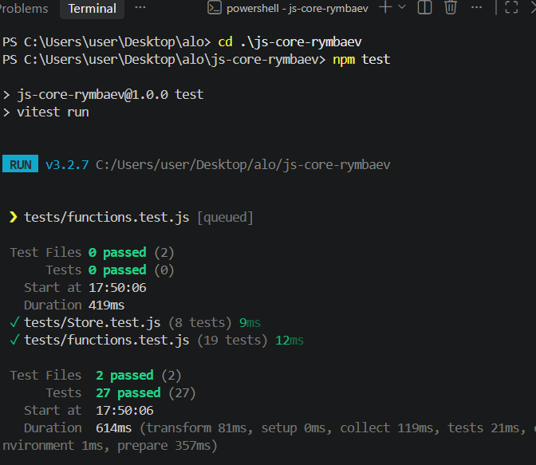

# Лабораторная работа №4 — JavaScript Core

## О проекте

В этой лабораторной работе я изучаю функции высшего порядка, замыкания, классы, наследование и модульное тестирование на JavaScript. Я реализовал набор утилит для работы с массивами и объектами, фабрику счётчика, а также классы `Store` и `SortedStore`.

Проект написан на чистом JavaScript и запускается в Node.js. Я не использую DOM, HTML, CSS или фреймворки.

## Использованные технологии

- JavaScript (ES6+)
- Node.js
- npm
- Vitest

## Структура проекта

```text
js-core-rymbaev/
├── src/
│   ├── functions.js
│   └── Store.js
├── tests/
│   ├── functions.test.js
│   └── Store.test.js
├── package.json
├── README.md
└── .gitignore
```

## Установка

Я устанавливаю LTS-версию Node.js, открываю папку проекта в Visual Studio Code и выполняю команду в интегрированном терминале:

```bash
npm install
```

## Запуск тестов

Чтобы запустить все тесты один раз, я выполняю:

```bash
npm test
```

Чтобы запускать тесты в режиме наблюдения за изменениями, я использую:

```bash
npm run test:watch
```

## Что я реализовал

### Функции (`src/functions.js`)

- `unique(arr)` — возвращает новый массив без повторяющихся значений, сохраняя порядок.
- `groupBy(arr, keyFn)` — группирует элементы по ключу, который вычисляет переданная функция.
- `chunk(arr, size)` — разбивает массив на части заданного размера и сообщает об ошибке для некорректного размера.
- `deepClone(obj)` — создаёт глубокую копию вложенных структур, включая массивы, `Map`, `Set`, даты, регулярные выражения и циклические ссылки.
- `memoize(fn)` — кэширует результаты вызовов функции с помощью замыкания.
- `counter()` — создаёт независимый счётчик с методами `inc()`, `dec()` и `value()`.

### Классы (`src/Store.js`)

- `Store` хранит элементы в приватном поле `Map` и предоставляет методы `add`, `remove`, `find`, `total`, геттер `size` и метод `getAll`. Я также добавил статический метод проверки элемента; хранилище отклоняет некорректные элементы и повторяющиеся идентификаторы.
- `SortedStore` наследуется от `Store` и переопределяет `getAll()`: этот метод использует `super.getAll()` и возвращает копию элементов, отсортированную по выбранному полю.

Я написал тесты на обычное поведение функций и классов, некорректные входные данные и граничные случаи с помощью Vitest.
